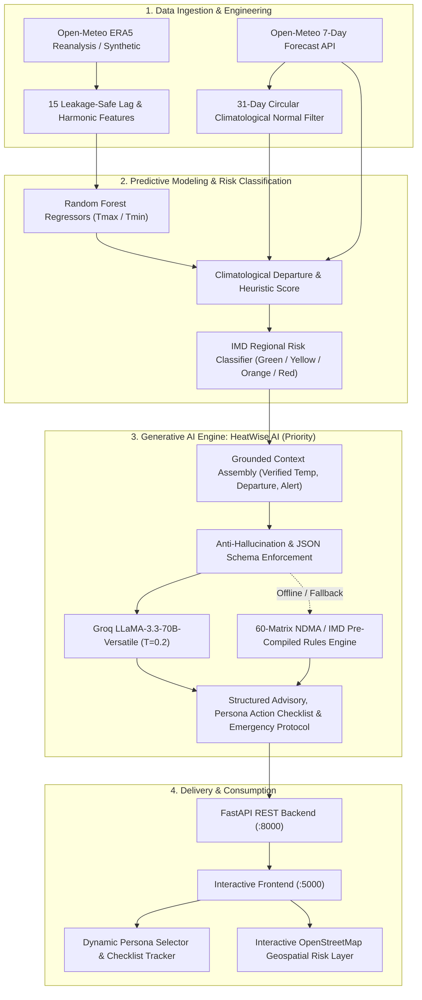
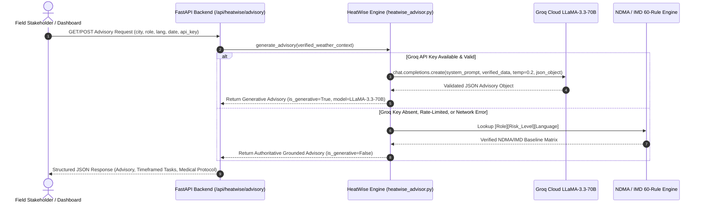
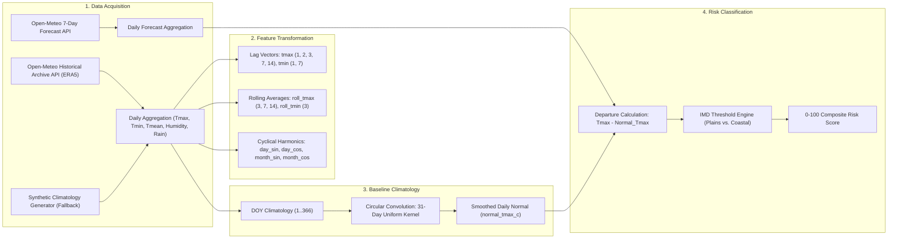
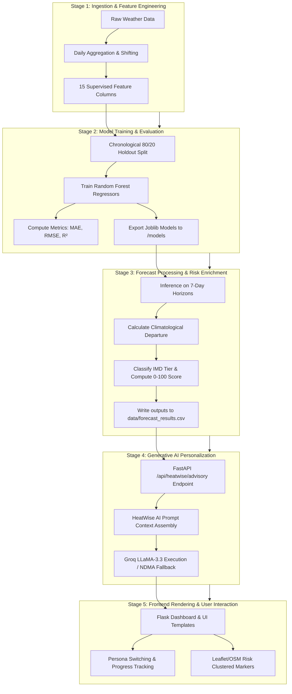

# Climate Intelligence: Heatwave Monitoring, Prediction & Early Warning System
## Comprehensive Technical Architecture & Project Structure Report

---

### Executive Overview

The **Climate Intelligence Heatwave System** is an end-to-end operational climate decision-support and risk-mitigation platform. It combines numerical and machine learning meteorological forecasting with **Generative Artificial Intelligence (HeatWise AI)** to translate complex climatological anomalies into persona-specific, actionable life-safety advisories and checklists across multiple languages.

Traditional meteorological bulletins present raw physical metrics—such as maximum temperatures ($T_{\text{max}}$), wet-bulb readings, and departure anomalies—that are difficult for non-specialist stakeholders to interpret into preventative actions. This platform bridges that gap by coupling an **IMD-aligned Climatological Risk Pipeline** with a **Grounded LLaMA-3.3 Generative AI Engine**, serving five distinct vulnerable societal cohorts (outdoor workers, school administrators, elderly populations, event organizers, and municipal planners) in English, Hindi, and Marathi.



---

### 1. Generative AI Advisory Engine: HeatWise AI (Core Priority)

The central operational innovation of this project is **[HeatWise AI](file:///c:/Users/mit33/Downloads/climate_intelligence_heatwave/climate_intelligence_heatwave/src/heatwise_advisor.py)**, a Generative AI advisory synthesis system that converts verified meteorological forecasts and alerts into role-tailored precautions, time-bound operational checklists, and critical medical protocols.



#### 1.1 Architectural Philosophy: Strict Anti-Hallucination Grounding

In disaster mitigation and extreme weather alerting, generative hallucinations can lead to loss of life or severe occupational injury. HeatWise AI implements strict **contextual grounding**:

1. **Parameter Hardening**: The generative model is prohibited from predicting or extrapolating raw meteorological values. The maximum temperature ($T_{\text{max}}$), minimum temperature ($T_{\text{min}}$), climatological departure ($\Delta T$), and categorical risk level (`GREEN`, `YELLOW`, `ORANGE`, `RED`) are computed deterministically by the meteorological pipeline and injected as immutable facts into the prompt.
2. **Deterministic Sampling**: The model operates with an inference temperature of `temperature=0.2`, suppressing creative variance in favor of strict compliance with established public health protocols.
3. **Structured Grammar Enforcement**: The Groq client enforces `response_format={"type": "json_object"}`, guaranteeing programmatic parsing without markdown noise or preamble.

#### 1.2 Prompt Engineering & Context Assembly

The contextual payload assembled by [call_groq_advisory](file:///c:/Users/mit33/Downloads/climate_intelligence_heatwave/climate_intelligence_heatwave/src/heatwise_advisor.py#L1284-L1383) injects verified regional and meteorological metadata into a structured system-user prompt pair:

```text
SYSTEM PROMPT:
You are 'HeatWise AI', a world-class, authoritative Generative AI Heatwave Advisor.
Your objective is to convert verified weather alerts into personalized, highly practical,
and actionable safety advisories.

STRICT GROUNDING RULES:
1. You MUST ground every recommendation strictly in the verified weather data provided below.
2. DO NOT hallucinate different temperatures or invent weather signals. The verified forecast
   values are absolute facts.
3. Align all advisories with official National Disaster Management Authority (NDMA) India
   and India Meteorological Department (IMD) standards.
4. Language Requirement: All output fields ('summary', 'priority_alert', 'precautions',
   'task', 'emergency_protocol') MUST be written in natural, fluent, native-level {target_lang}.
5. You MUST return STRICTLY a JSON object matching this schema without markdown wrapping:
{
  "summary": "2-3 concise sentences contextualizing the exact temperature, departure, and target group risk",
  "priority_alert": "One sharp headline or imperative instruction for this role",
  "precautions": ["Precise precaution 1", "Precise precaution 2", "Precise precaution 3", "Precise precaution 4"],
  "actionable_checklist": [
    {"task": "Actionable task description", "timeframe": "Time e.g. 07:00 or Morning", "priority": "High|Medium"}
  ],
  "emergency_protocol": "Clear, practical steps if someone in this group suffers heat exhaustion or heat stroke",
  "official_citations": ["NDMA Heat Wave Guidelines", "IMD Heat Action Plan"]
}
```

#### 1.3 Persona-Specific Personalization (5 Target Roles)

Advisories cannot be generic. A threshold crossing $42^\circ\text{C}$ requires entirely distinct operational responses depending on institutional agency:

| Role Identifier | Cohort Name | Focus Area & Institutional Mandate |
| :--- | :--- | :--- |
| `outdoor_workers` | **Outdoor & Construction Workers** | Occupational heat stress mitigation, split-shift rescheduling ($06:00-11:00$ and $16:30-19:30$), mandatory shaded hydration intervals, buddy monitoring, wet-bulb cooling. |
| `school_admins` | **School Administrators & Educators** | Child protection, suspension of midday outdoor sports/assemblies ($10:30-15:30$), classroom cross-ventilation, "Water Bell" (जल घंटी) drill execution, cool-transit dispatch. |
| `older_adults` | **Older Adults & Vulnerable Groups** | Geriatric public health, chronic cardiovascular and renal symptom monitoring, heat-stress vasodilation mitigation, indoor passive cooling, caregiver check-in schedules. |
| `event_organisers` | **Event Organizers & Crowd Managers** | Mass gathering risk reduction, shaded staging, misting fans, free drinking-water kiosk distribution, dedicated medical tent readiness, crowd-surge heat exhaustion triaging. |
| `municipal_officials` | **Municipal Officials & City Planners** | Civic governance, activation of City Heat Action Plans (HAP), mobile water tanker re-routing to informal settlements, public cooling center opening, hospital heat-ward readiness. |

#### 1.4 Native Multilingual Generation

HeatWise AI supports native trilingual generation using native Devanagari scripts and authentic disaster-management lexicons rather than naive transliterations:

* **English (`en`)**: Formal, operational tone geared toward administrative and enterprise execution.
* **Hindi (`hi`)**: Culturally grounded terminology including *लू* (heatwave), *उष्माघात* (heat stroke), *जल घंटी* (water bell), and *छायादार विश्राम स्थल* (shaded rest zones).
* **Marathi (`mr`)**: Specialized regional terminology used in Maharashtra State Disaster Management plans including *उष्णतेची लाट* (heatwave), *ताक व लिंबू सरबत* (electrolytic fluids), and *प्रभाग अधिकारी* (ward officers).

#### 1.5 Authoritative 60-Scenario NDMA / IMD Offline Fallback Matrix

To guarantee zero service interruption during connectivity loss, API rate-limiting, or local offline air-gapped deployments, [heatwise_advisor.py](file:///c:/Users/mit33/Downloads/climate_intelligence_heatwave/climate_intelligence_heatwave/src/heatwise_advisor.py#L109-L1252) embeds a deterministic reference knowledge base:

$$\text{Total Pre-compiled Scenarios} = 5 \text{ Roles} \times 4 \text{ Alert Levels (Green, Yellow, Orange, Red)} \times 3 \text{ Languages} = 60 \text{ Authoritative Matrices}$$

Each entry incorporates verified recommendations extracted directly from:
1. *NDMA National Guidelines for Preparation of Action Plan - Prevention and Management of Heat Wave (2019)*.
2. *IMD Heat Action Plan & Heat Index Criteria Guidelines*.
3. *Occupational Safety, Health and Working Conditions Code (2020)*.

---

### 2. Dataset Architecture & Climatological Engineering

The dataset design models extreme thermodynamic events while preventing temporal target leakage.



#### 2.1 Monitored Metropolitan Geographies

The system monitors five high-risk Indian metropolitan regions across varied microclimatic regimes:

| City | Latitude | Longitude | Region Type | Climatological Regime | Base Threshold ($T_{\text{max}}$) |
| :--- | :--- | :--- | :--- | :--- | :--- |
| **Pune** | $18.5204^\circ\text{N}$ | $73.8567^\circ\text{E}$ | Plains | Semi-arid Deccan Plateau | $40.0^\circ\text{C}$ |
| **Mumbai** | $19.0760^\circ\text{N}$ | $72.8777^\circ\text{E}$ | Coastal | Humid Tropical Coastal | $37.0^\circ\text{C}$ |
| **Nagpur** | $21.1458^\circ\text{N}$ | $79.0882^\circ\text{E}$ | Plains | Continental Central India (Severe dry heat) | $40.0^\circ\text{C}$ |
| **Delhi** | $28.6139^\circ\text{N}$ | $77.2090^\circ\text{E}$ | Plains | Subtropical Semi-Arid (Northern plains) | $40.0^\circ\text{C}$ |
| **Ahmedabad** | $23.0225^\circ\text{N}$ | $72.5714^\circ\text{E}$ | Plains | Hot Semi-Arid Western India | $40.0^\circ\text{C}$ |

#### 2.2 Ingestion Protocols & Synthetic Demo Engine

1. **Live Ingestion**:
   * *Historical Records*: [fetch_open_meteo_history](file:///c:/Users/mit33/Downloads/climate_intelligence_heatwave/climate_intelligence_heatwave/src/climate_pipeline.py#L54-L93) queries Open-Meteo's ERA5 reanalysis archive from `2015-01-01` to present date, aggregating hourly $2\text{m}$ temperature, relative humidity, and precipitation into daily statistics.
   * *Operational Forecasts*: [fetch_open_meteo_forecast](file:///c:/Users/mit33/Downloads/climate_intelligence_heatwave/climate_intelligence_heatwave/src/climate_pipeline.py#L96-L140) extracts 7-day numerical forecasts.
2. **Synthetic Climatology Generator**:
   When offline, [generate_synthetic_history](file:///c:/Users/mit33/Downloads/climate_intelligence_heatwave/climate_intelligence_heatwave/src/climate_pipeline.py#L143-L192) synthesizes a multi-year climatological record using deterministic physics:
   $$T_{\text{max}}(d) = 31.0 + \Delta_{\text{city}} + 7.0 \cos\left(\frac{2\pi(d - 135)}{365.25}\right) + \epsilon_{\text{daily}}$$
   Where $d$ is the day of the year (peaking around May 15 at day 135), $\Delta_{\text{city}}$ represents geographical bias, and $\epsilon_{\text{daily}} \sim \mathcal{N}(0, 1.9)$. Southwest monsoon dampening (June–September) and multi-day heatwave spell injections ensure realistic validation conditions.

#### 2.3 Supervised Feature Engineering (15 Leakage-Safe Predictors)

To ensure zero future-data leakage, all predictors in [make_supervised](file:///c:/Users/mit33/Downloads/climate_intelligence_heatwave/climate_intelligence_heatwave/src/climate_pipeline.py#L195-L216) are strictly lagged by $\ge 1$ day:

* **Lagged Extremes (7 features)**:
  * $T_{\text{max}}$ Lags: $t-1, t-2, t-3, t-7, t-14$
  * $T_{\text{min}}$ Lags: $t-1, t-7$
* **Rolling Window Statistics (4 features)**:
  * 3-day rolling mean: $\frac{1}{3}\sum_{k=1}^3 T_{\text{max}}(t-k)$
  * 7-day rolling mean: $\frac{1}{7}\sum_{k=1}^7 T_{\text{max}}(t-k)$
  * 14-day rolling mean: $\frac{1}{14}\sum_{k=1}^{14} T_{\text{max}}(t-k)$
  * 3-day rolling minimum mean: $\frac{1}{3}\sum_{k=1}^3 T_{\text{min}}(t-k)$
* **Cyclical Temporal Harmonics (4 features)**:
  * $\text{day\_sin} = \sin\left(\frac{2\pi \cdot \text{DOY}}{365.25}\right), \quad \text{day\_cos} = \cos\left(\frac{2\pi \cdot \text{DOY}}{365.25}\right)$
  * $\text{month\_sin} = \sin\left(\frac{2\pi \cdot \text{Month}}{12}\right), \quad \text{month\_cos} = \cos\left(\frac{2\pi \cdot \text{Month}}{12}\right)$

#### 2.4 Climatological Normal Calculation (Circular Kernel Smoothing)

A baseline normal is calculated for every calendar day via [climatology_normals](file:///c:/Users/mit33/Downloads/climate_intelligence_heatwave/climate_intelligence_heatwave/src/climate_pipeline.py#L326-L344):
1. Historical daily maximum temperatures are grouped by day of year ($d \in [1, 366]$).
2. To eliminate edge discontinuity between December 31 and January 1, the 366-day vector is symmetrically padded with 15 days on each end:
   $$A_{\text{extended}} = [A_{352..366}, A_{1..366}, A_{1..15}]$$
3. A 31-day uniform convolution moving-average filter is applied:
   $$N(d) = \frac{1}{31} \sum_{k=-15}^{15} A(d + k)$$
This yields a continuous, smooth normal curve free of localized weather anomalies.

#### 2.5 IMD Heatwave Classification Logic & 0–100 Heuristic Risk Score

The classification engine in [classify_risk](file:///c:/Users/mit33/Downloads/climate_intelligence_heatwave/climate_intelligence_heatwave/src/climate_pipeline.py#L346-L386) implements IMD operational heatwave criteria:

```text
Plains Stations (Pune, Nagpur, Delhi, Ahmedabad):
├── RED (Severe Heatwave):      Tmax >= 47.0°C  OR  (Tmax >= 40.0°C and Departure >= +6.5°C)
├── ORANGE (Heatwave):          Tmax >= 45.0°C  OR  (Tmax >= 40.0°C and Departure >= +4.5°C)
├── YELLOW (Heat Watch):        Tmax >= 40.0°C  OR  Departure >= +4.5°C  OR  (Tmax >= 37.0°C and Humidity >= 75%)
└── GREEN (Normal):             All other conditions

Coastal Stations (Mumbai):
├── RED (Severe Coastal Heat):  Tmax >= 45.0°C  OR  (Tmax >= 37.0°C and Departure >= +6.5°C)
├── ORANGE (Coastal Heatwave):  Tmax >= 37.0°C and Departure >= +4.5°C
├── YELLOW (Coastal Watch):     Tmax >= 37.0°C  OR  Departure >= +4.5°C
└── GREEN (Normal):             All other conditions
```

##### Explainable Composite Risk Score (0–100)
To provide a smooth, continuous indicator for trend visualization and alert triggers, a three-factor heuristic risk score is computed:

$$\text{Risk Score} = S_{\text{temp}} + S_{\text{anomaly}} + S_{\text{humidity}}$$

Where:
* $S_{\text{temp}} = \text{clip}\left(\frac{T_{\text{max}} - 32.0}{15.0} \times 50.0, 0, 50\right)$ (Weight: 50 points)
* $S_{\text{anomaly}} = \text{clip}\left(\frac{\max(\Delta T, 0.0)}{7.0} \times 25.0, 0, 25\right)$ (Weight: 25 points)
* $S_{\text{humidity}} = \text{clip}\left(\frac{\text{Humidity} - 40.0}{50.0} \times 15.0, 0, 15\right)$ (Weight: 15 points)

---

### 3. End-to-End System Pipeline

The system pipeline operates across five integrated stages, linking offline machine learning with real-time generative advisory generation:



1. **Ingestion & Feature Preparation**: Historical and prospective weather data are cleaned, verified, and mapped into 15 lagged and cyclical features.
2. **Machine Learning Model Training**: For each city, two distinct `RandomForestRegressor` models are trained (one for $T_{\text{max}}$, one for $T_{\text{min}}$). The models are validated on an 80/20 chronological holdout set, achieving $R^2 \approx 0.85 - 0.94$ on seasonal variation.
3. **Forecast & Anomaly Scoring**: Prospective 7-day numerical forecasts are evaluated against the 31-day circular smoothed normal to compute positive temperature anomalies ($\Delta T$). Risk tiers and composite scores are assigned.
4. **Generative AI Advisory Synthesis**: The FastAPI backend routes validated forecast data through `src/heatwise_advisor.py`. The system attempts Groq LLaMA-3.3-70B synthesis; if unavailable, it seamlessly engages the 60-scenario pre-compiled NDMA matrix.
5. **Interactive UI Delivery**: The dashboard renders live forecast cards, risk badges, interactive OpenStreetMap visualizations, what-if climate uplift sliders, and the HeatWise AI persona advisory center with interactive task checklists.

---

### 4. Project Directory Structure

Below is the repository structure:

```text
climate_intelligence_heatwave/
├── data/                                 # Centralized Data Storage Layer
│   ├── alerts.csv                        # Non-green active heat warnings
│   ├── forecast_daily.csv                # Raw prospective 7-day forecasts
│   ├── forecast_results.csv              # Processed forecasts with risk tiers and scores
│   ├── historical_daily.csv              # Multi-year historical meteorological series
│   ├── historical_risk.csv               # Historical records enriched with risk levels
│   ├── model_feature_importance.csv      # Gini importance scores across features
│   └── model_metrics.csv                 # MAE, RMSE, and R² scores per city model
│
├── models/                               # Serialized Machine Learning Model Storage
│   ├── ahmedabad_tmax.joblib             # Trained Random Forest Regressor (Tmax - Ahmedabad)
│   ├── ahmedabad_tmin.joblib             # Trained Random Forest Regressor (Tmin - Ahmedabad)
│   ├── delhi_tmax.joblib                 # Trained Random Forest Regressor (Tmax - Delhi)
│   ├── delhi_tmin.joblib                 # Trained Random Forest Regressor (Tmin - Delhi)
│   ├── mumbai_tmax.joblib                # Trained Random Forest Regressor (Tmax - Mumbai)
│   ├── mumbai_tmin.joblib                # Trained Random Forest Regressor (Tmin - Mumbai)
│   ├── nagpur_tmax.joblib                # Trained Random Forest Regressor (Tmax - Nagpur)
│   ├── nagpur_tmin.joblib                # Trained Random Forest Regressor (Tmin - Nagpur)
│   ├── pune_tmax.joblib                  # Trained Random Forest Regressor (Tmax - Pune)
│   └── pune_tmin.joblib                  # Trained Random Forest Regressor (Tmin - Pune)
│
├── src/                                  # Core Scientific, ML & Generative AI Modules
│   ├── config.py                         # Configuration constants, city coordinates, alert palettes
│   ├── climate_pipeline.py               # Ingestion, feature engineering, RF training & IMD risk logic
│   ├── heatwise_advisor.py               # Generative AI Advisor: Groq LLaMA-3.3 + 60 NDMA fallbacks
│   └── run_pipeline.py                   # CLI orchestrator to execute full training & inference
│
├── dashboard/                            # Web Application Presentation Layer
│   ├── api.py                            # FastAPI REST service serving forecast, metrics & HeatWise
│   ├── app.py                            # Flask UI application serving server-rendered templates
│   ├── server.py                         # Multi-service development launcher (Ports 8000 & 5000)
│   ├── static/                           # Client-side static assets
│   │   ├── css/
│   │   │   └── dashboard.css             # Glassmorphism design system & responsive layout styles
│   │   └── js/
│   │       ├── dashboard.js              # DOM controllers, Leaflet maps & chart rendering
│   │       └── heatwise.js               # HeatWise AI state machine, Groq BYOK key manager & checklists
│   └── templates/
│       └── index.html                    # Responsive dashboard interface with HeatWise advisory center
│
├── rightsize/                            # Cloud Resource Right-Sizing & Efficiency Optimization
│   ├── benchmarker.py                    # Workload stress testing & throughput simulation
│   ├── collector.py                      # Continuous background CPU/memory utilization telemetry
│   ├── cost_model.py                     # AWS EC2 compute cost modeling & instance pricing tables
│   └── recommender.py                    # Right-sizing engine for over-provisioned cloud workloads
│
├── k8s/                                  # Kubernetes Deployment & Orchestration Manifests
│   ├── api-deployment.yaml               # Kubernetes deployment for FastAPI backend
│   ├── api-service.yaml                  # ClusterIP service for FastAPI
│   ├── frontend-deployment.yaml          # Kubernetes deployment for Flask UI
│   ├── frontend-service.yaml             # NodePort/LoadBalancer service for Flask UI
│   └── ingress.yaml                      # Ingress routing rules for reverse proxying
│
├── tests/                                # Automated Unit & Integration Testing Suite
│   ├── test_climate_pipeline.py          # Regression tests for feature engineering & risk classification
│   └── test_heatwise_advisor.py          # Validation tests for Groq prompts & fallback integrity
│
├── climate_rightsize_tui.py              # Interactive Terminal UI for right-sizing analysis
├── docker-compose.yml                    # Multi-container orchestration (API + Frontend)
├── Dockerfile.api                        # Container specification for FastAPI service
├── Dockerfile.frontend                   # Container specification for Flask frontend
├── requirements.txt                      # Project dependencies (FastAPI, Groq, scikit-learn, etc.)
├── README.md                             # Repository overview and setup documentation
├── PROJECT_BRIEF.md                      # Foundational project requirements and problem statement
├── DOCKER_K8S_GUIDE.md                   # Containerization and Kubernetes deployment instructions
└── AWS_EC2_DEPLOYMENT.md                 # Production cloud deployment guide for AWS EC2
```

---

### 5. High-Level Technology Stack Summary

As required, this section provides a concise reference of technologies used across the system architecture:

| System Layer | Technology / Framework | Primary Responsibility |
| :--- | :--- | :--- |
| **Generative AI** | **Groq API (`llama-3.3-70b-versatile`)** | Persona-tailored advisory synthesis, multi-lingual translation, structured checklist generation. |
| **Core Runtime** | **Python 3.10+** | Scientific computation, API services, and modeling pipeline. |
| **Machine Learning** | **scikit-learn (`RandomForestRegressor`)** | Local regression modeling of $T_{\text{max}}$ and $T_{\text{min}}$ with chronological validation. |
| **Data Processing** | **Pandas & NumPy** | Data ingestion, lag generation, circular convolution smoothing, and risk heuristics. |
| **Backend Services** | **FastAPI & Uvicorn** | High-performance asynchronous REST API serving risk metrics, forecast tables, and AI endpoints. |
| **Frontend UI** | **Flask, Jinja2 & Vanilla CSS** | Glassmorphic web application with responsive grid layout and dark-mode aesthetics. |
| **Visualization** | **Leaflet.js & OpenStreetMap** | Interactive geospatial risk mapping with custom colored SVG circular markers. |
| **Cloud & Containers**| **Docker, Kubernetes (k3s) & AWS EC2**| Microservice containerization, horizontal pod scaling, and cloud right-sizing analysis. |

---

### 6. Verification and Demonstration Protocols

#### 6.1 Executing the Core Pipeline
To ingest data, engineer features, fit city models, and populate forecasts:
```bash
python src/run_pipeline.py --refresh
```

#### 6.2 Launching the Complete System
To launch both the FastAPI REST engine (`:8000`) and the Flask dashboard (`:5000`):
```bash
python dashboard/server.py
```

#### 6.3 Validating HeatWise AI Generative Endpoints
Query the persona advisory endpoint directly via `curl`:
```bash
# Querying outdoor worker advisory for Pune in Marathi
curl -X GET "http://localhost:8000/api/heatwise/advisory?city=Pune&role=outdoor_workers&language=mr"
```
Response sample (grounded JSON):
```json
{
  "city": "Pune",
  "date": "2026-10-15",
  "role": "outdoor_workers",
  "role_label": "बांधकाम व मैदानी कामगार",
  "language": "mr",
  "risk_level": "ORANGE",
  "risk_score": 76.5,
  "model_used": "LLaMA 3.3 70B Versatile (via Groq AI)",
  "is_generative": true,
  "advisory": {
    "summary": "पुणे शहरात कमाल तापमान 41.2°C राहण्याचा अंदाज असून हे सामान्यपेक्षा 4.8°C जास्त आहे. मैदानी कामगारांसाठी उष्माघाताचा तीव्र धोका संभवतो.",
    "priority_alert": "दुपारी १२ ते ४ दरम्यान उन्हातील जड कामे तत्काळ थांबवा",
    "precautions": [
      "कामाच्या वेळा सकाळी ०६:०० ते ११:०० आणि दुपारी १६:३० नंतर बदला.",
      "तहान नसली तरी दर २० मिनिटांनी पुरेसे पाणी किंवा ओआरएस प्या."
    ],
    "actionable_checklist": [
      {"task": "हवेशीर सावलीचे विश्राम केंद्र सज्ज करा", "timeframe": "०८:००", "priority": "High"},
      {"task": "सर्व कामगारांना ओआरएस व पिण्याचे पाणी वितरित करा", "timeframe": "१०:३०", "priority": "High"}
    ],
    "emergency_protocol": "उष्माघात झाल्यास रुग्णास सावलीत नेऊन डोक्यावर थंड पाण्याचा मारा करावा व त्वरित १०८ ला कॉल करावा."
  }
}
```
